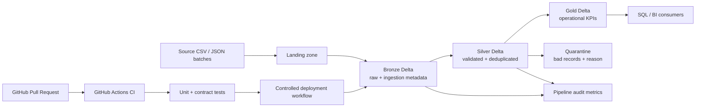

# Supply Chain Lakehouse Platform
**Enterprise-style Data Engineering portfolio project** | PySpark · Delta Lake · Databricks Free Edition · GitHub Actions

> This is a portfolio implementation using synthetic data. It is designed to demonstrate production-oriented engineering patterns without Azure or paid cloud dependencies. Databricks workspace capabilities and free-tier quotas may constrain deployment-specific features.

## Business problem
A logistics company receives order, inventory snapshot, and shipment-event feeds from multiple operational systems. Data arrives late, contains duplicates and invalid records, and must support reliable operational KPIs.

## Outcomes
- Incremental ingestion with replay-safe processing patterns.
- Bronze / Silver / Gold lakehouse layers.
- Data contracts, quarantine, audit metrics, and reconciliation.
- Shipment event deduplication and late-arriving event handling.
- Delta Lake optimization experiments with measured results.
- Git-based development, automated tests, linting, and deployment configuration.

## Architecture


## Data products
| Product | Grain | Purpose |
|---|---|---|
| `bronze_orders` | source order record | Preserve source payload and ingestion metadata |
| `bronze_shipment_events` | source event record | Preserve shipment lifecycle events |
| `bronze_inventory_snapshots` | inventory snapshot | Preserve inventory state by product and warehouse |
| `silver_shipment_events` | unique valid event | Canonical event history with duplicate handling |
| `silver_inventory` | product × warehouse × snapshot | Validated stock position |
| `gold_shipment_sla` | shipment | First shipped/delivered times and delivery duration |
| `gold_inventory_risk` | product × warehouse | Below-threshold and stockout indicators |

## Repository layout
```text
src/supply_chain/
  config.py              # typed project settings
  contracts.py           # schema/data contract definitions
  quality.py             # deterministic validation rules
  deduplication.py       # event deduplication helpers
  metrics.py             # audit and reconciliation helpers
  generator.py           # synthetic data generation
scripts/
  generate_data.py
tests/
  unit/
  contract/
notebooks/
  00_environment_check.py
  01_bronze_ingestion.py
  02_silver_quality.py
  03_gold_products.py
  04_optimization_lab.py
.github/workflows/
  ci.yml
  deploy.yml
docs/
  architecture.md
  data_dictionary.md
  runbook.md
  adr/0001-free-first-platform.md
databricks.yml           # deployment bundle scaffold; configure only if supported
```

## Quick start: local quality gate
Requires Python 3.11+ and Git. These checks do not require Spark or a cloud account.

### Windows PowerShell
```powershell
py -3.12 -m venv .venv
.\.venv\Scripts\Activate.ps1
python -m pip install --upgrade pip
pip install -e ".[dev]"
pytest
ruff check .
python scripts/generate_data.py --output-dir data/generated --rows 1000
```

### macOS / Linux
```bash
python3 -m venv .venv
source .venv/bin/activate
python -m pip install --upgrade pip
pip install -e ".[dev]"
pytest
ruff check .
python scripts/generate_data.py --output-dir data/generated --rows 1000
```

Generated data is ignored by Git. Do not commit credentials, tokens, customer data, or generated files containing sensitive information.

## Engineering standards
- **Idempotency:** repeated processing of the same batch must not create duplicate business events.
- **Data contracts:** required columns, types, and business rules are explicit and testable.
- **Quarantine:** rejected records retain source identifiers and machine-readable rejection reasons.
- **Observability:** each run should record run ID, source batch, input/output/rejected counts, and status.
- **Incrementality:** process only newly discovered input or changed records, using a durable checkpoint/watermark where supported.
- **Performance:** compare equivalent workloads; record data volume, warm/cold run, runtime, file count, bytes scanned (when available), and query plan.
- **Security:** use secret scopes or supported workspace secret mechanisms; never hard-code credentials.

## CI/CD
- `ci.yml` runs Ruff and unit/contract tests on pushes and pull requests.
- `deploy.yml` is a manually triggered deployment scaffold. It requires GitHub repository secrets `DATABRICKS_HOST` and `DATABRICKS_TOKEN`, plus a valid target configured in `databricks.yml`. Do not configure these until your workspace supports the chosen deployment method. The workflow is intentionally not part of the default CI gate.
- Keep deployment disabled until tested against Databricks Free Edition and its current feature limits.

## Project milestones
1. **Foundation:** contracts, deterministic synthetic data, unit tests, CI. 
2. **Bronze:** create Delta tables and persist raw records with batch/run metadata.
3. **Silver:** validate, quarantine, deduplicate, and handle late events.
4. **Incremental reliability:** watermarks/checkpoints, replay safety, MERGE/upsert tests.
5. **Gold products:** shipment SLA, delivery delay, warehouse inventory risk.
6. **Optimization:** physical plans, join strategies, file-size distribution, supported compaction/layout.
7. **Release engineering:** test deployment configuration, tag a version, publish benchmark report.

## Definition of done
A milestone is complete only when code, tests, run instructions, and evidence are committed. Never claim a performance gain, production deployment, or scale figure without reproducible measurements.
